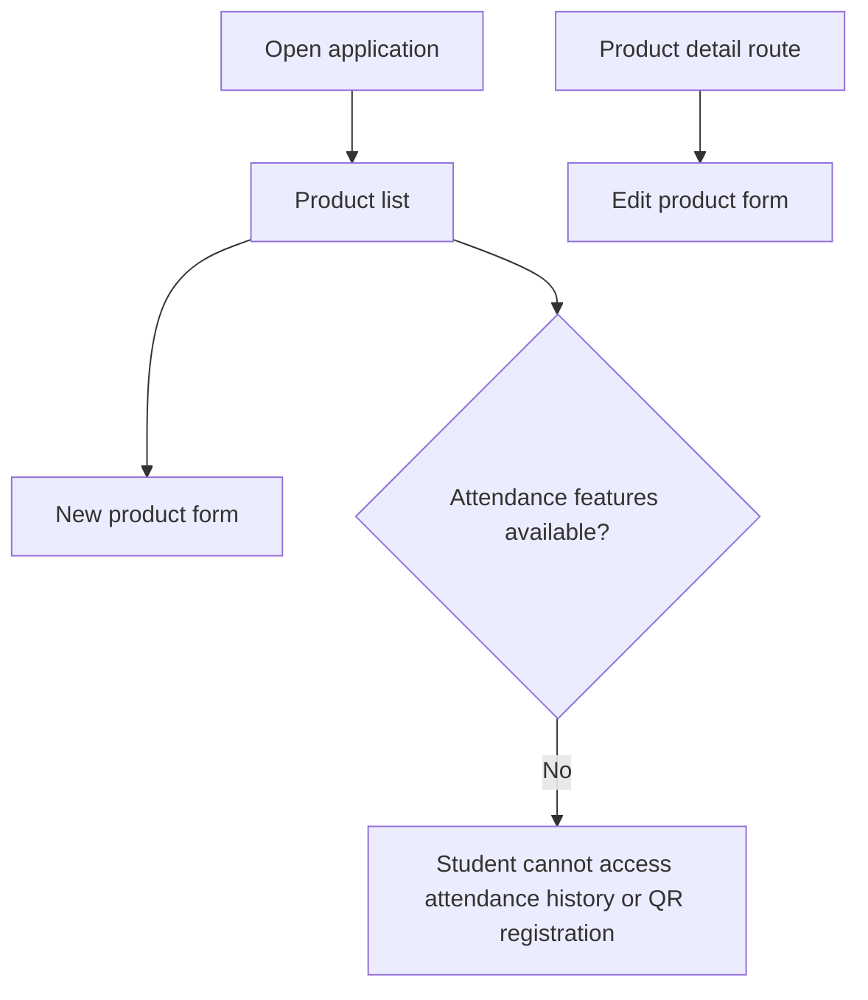
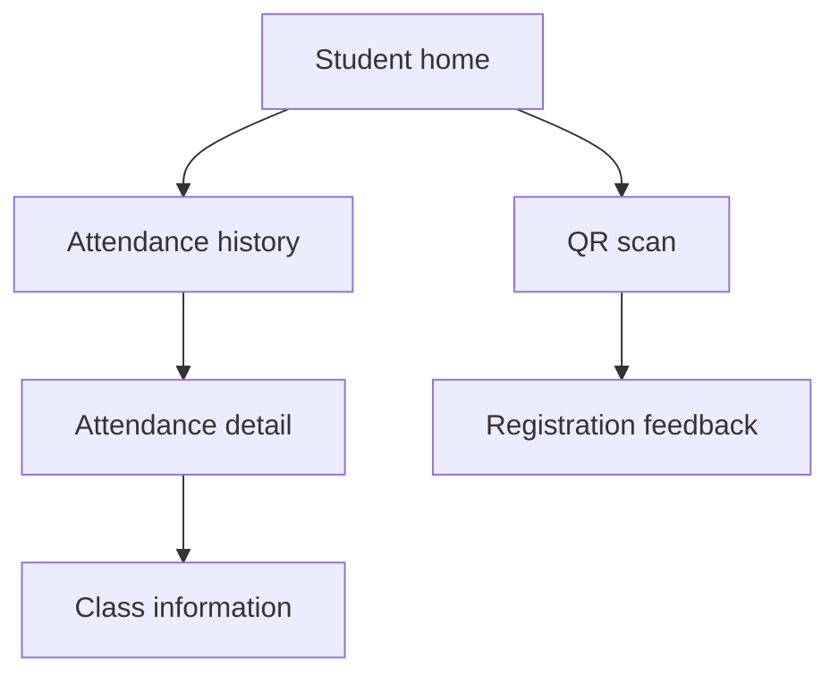

# CP1 - UX Audit: Attendance Control

## 1. Context

Project: Attendance Control
Student: Andres Felipe Calle Gonzalez
Role evaluated: STUDENT
Technology: Ionic React

The backend supports courses, class sessions and attendance registration through QR codes.

The mobile frontend is not implemented yet. The current baseline is the official Ionic React starter, which contains a product catalog.

This audit identifies the current interface limitations and the changes required to adapt it to Attendance Control.

## 2. Selected screens

| Current baseline | Attendance Control target |
|---|---|
| ProductListPage | Attendance History |
| ProductDetailPage | Class Detail |
| ProductFormPage | QR Attendance Registration |

The target screens are planned improvements, not existing implementations.

## 3. UX findings

| Screen | Finding | UX principle | Severity | Proposed solution |
|---|---|---|---|---|
| List | Displays products instead of attendance records | Domain consistency | High | Show the student's attendance history |
| List | Loading uses a text message instead of a skeleton | System status visibility | Medium | Use IonSkeletonText with attendance rows |
| List | An empty API response produces an empty list without explanation | Empty state feedback | High | Display a message and a useful action |
| List | Each row displays only a product name | Information hierarchy | High | Display course name and attendance date |
| List | Rows do not provide navigation to attendance details | Navigation clarity | High | Make attendance rows navigable |
| Detail | The starter shows placeholder text rather than loaded information | Content clarity | High | Display real class and attendance details |
| QR registration | No QR registration screen exists in the starter | Task completion | High | Create a QR registration flow |
| Navigation | Routes focus on product management and do not connect attendance features | Navigation consistency | High | Introduce navigation for history, classes and QR |
| Error state | The starter provides retry, but the message is not specific to attendance | User feedback | Medium | Provide attendance-specific error messages |

## 4. Real backend elements

The Attendance Control backend provides:

- GET /api/attendance/history
- POST /api/attendance/register
- GET /api/attendance/class/{classSessionId}
- GET /api/classes/course/{courseId}
- POST /api/classes/{classSessionId}/qr

The attendance response includes fields such as courseName, classSessionId and dateTime.

These elements will guide the mobile interface instead of using generic sample information.

## 5. Current navigation map

The current starter does not provide navigation from its list rows to the product detail route.

The main problem for Attendance Control is that a student cannot complete the attendance workflow using this baseline.

## 6. Proposed navigation

## 7. Accessibility and responsive checks

The following aspects require browser verification:

- Text and background contrast.
- Accessible labels for buttons.
- Touch targets of at least 44 pixels.
- Readable text on small screens.
- Layout at 360 px and 768 px widths.
- Feedback that does not depend only on colors.

These checks are pending browser validation and will be addressed in CP4.

## 8. Baseline screenshots

The screenshots must come from the running application.

Required files:

- docs/img/before-list.png
- docs/img/before-detail.png
- docs/img/before-form.png

Screenshots remain pending until the application is executed locally.

## 9. Priorities

The first improvement will be the attendance history list because students need a clear way to check previously registered attendance.

The second improvement will be the navigation between history and class details.

The third improvement will be QR registration feedback so students understand whether attendance was successfully recorded.

