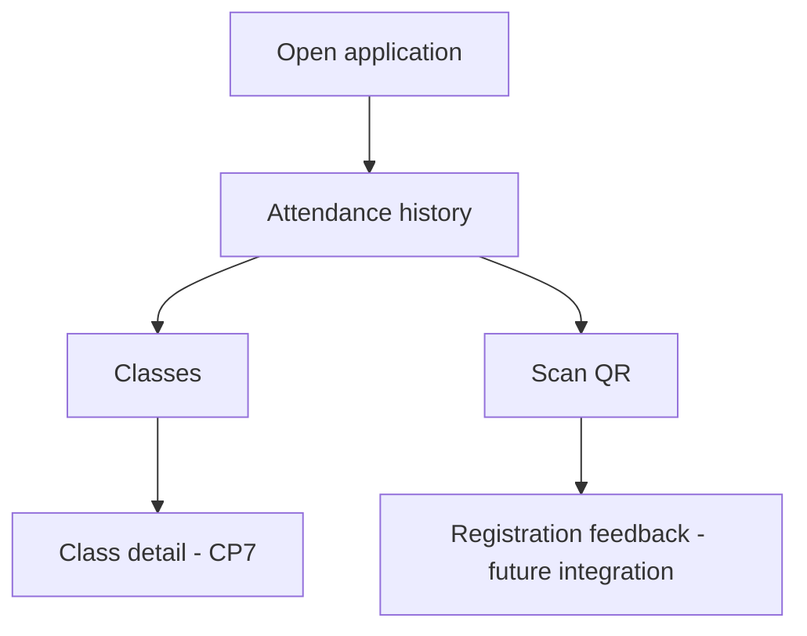

# CP2 - Navigation and Design Tokens

## 1. Application context

Project: Attendance Control
Student: Andres Felipe Calle Gonzalez
Role: STUDENT
Technology: Ionic React

The mobile experience focuses on attendance history, course sessions, and QR-based attendance registration.

## 2. Navigation pattern

The selected navigation pattern is a bottom tab bar.

This pattern is appropriate because students need direct access to three main sections:

- Historial: review registered attendance.
- Clases: access course and class information.
- Escanear QR: access the attendance registration flow.

Tabs reduce the number of interactions required to move between frequently used sections.

Class details will use stack navigation, allowing the student to return to the previous screen without losing context.

## 3. Proposed routes

| Route | Screen | Purpose |
|---|---|---|
| /tabs/historial | AttendanceHistoryPage | Review attendance records |
| /tabs/clases | ClassesPage | Access class sessions |
| /tabs/escanear | QrScanPage | Start QR attendance registration |
| /clases/:id | ClassDetailPage | View class details in CP7 |

The class detail route is planned for CP7.

## 4. Navigation flow

## 5. Design tokens

The palette uses a dark green as the main color, with blue for secondary elements and a light background for readability.

| Token | Value | Purpose |
|---|---|---|
| Primary | #0B6E4F | Main navigation and actions |
| Secondary | #17324D | Secondary visual elements |
| Success | #166534 | Successful attendance |
| Danger | #B42318 | Errors and failed requests |
| Background | #F6F8FA | Application background |
| Text | #1B2838 | Main text |
| Surface | #FFFFFF | Content areas |

## 6. Contrast verification

Contrast ratios are calculated using the WCAG relative luminance formula.

| Foreground | Background | Contrast | Result |
|---|---|---|---|
| #0B6E4F | #FFFFFF | 6.25:1 | Pass |
| #17324D | #FFFFFF | 13.13:1 | Pass |
| #166534 | #FFFFFF | 7.13:1 | Pass |
| #B42318 | #FFFFFF | 6.57:1 | Pass |
| #1B2838 | #F6F8FA | 14.02:1 | Pass |

All listed combinations exceed the WCAG AA minimum of 4.5:1 for normal text.

Contrast checker:
https://webaim.org/resources/contrastchecker/

## 7. Typography

| Token | Value |
|---|---|
| Font family | System UI |
| Main title | 1.5rem |
| Body text | 1rem |
| Secondary text | 0.875rem |

Relative font units support user text scaling.

## 8. Spacing

| Token | Value |
|---|---|
| Small | 0.5rem |
| Medium | 1rem |
| Large | 1.5rem |

Spacing tokens help maintain a consistent layout across screens.

## 9. Implementation plan

The existing product navigation will be replaced with three attendance-related tabs.

The attendance history will become the initial screen.

The QR screen will initially provide a clear entry point. Camera scanning and backend registration require later integration.

The design tokens will be defined in a single theme file to avoid repeated color and spacing values.

## 10. Verification

The navigation and theme changes must be tested in the running Ionic React application before CP2 is marked complete.
