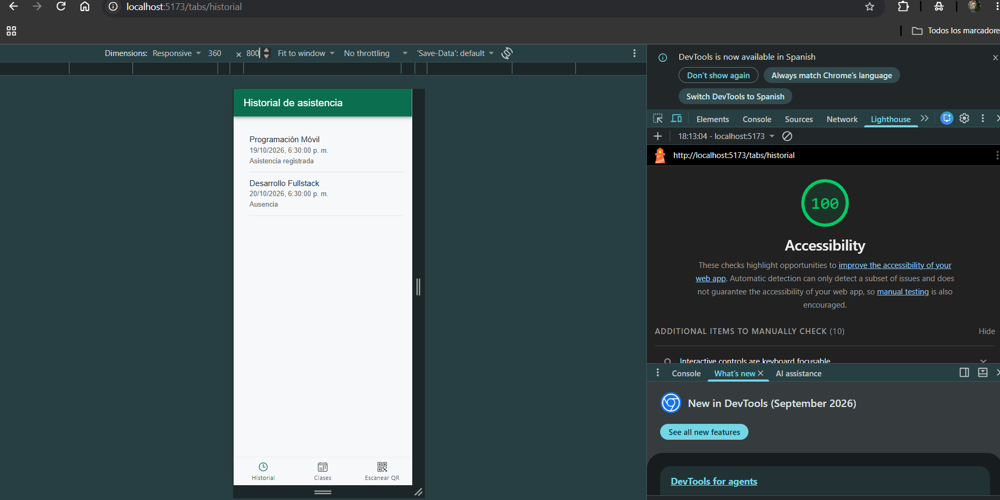
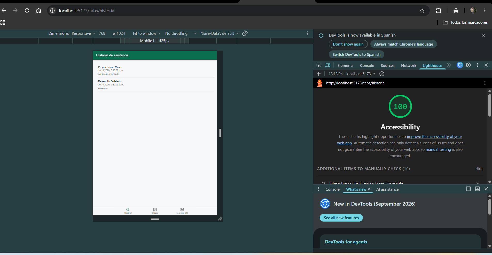

# CP4 - Accessibility and Responsive Design

## 1. Project Information

- Application: Attendance Control
- Technology: Ionic React and TypeScript
- Checkpoint: CP4 - Accessibility and Responsive Design
- Main screen: Attendance History

## 2. Objective

Improve the accessibility and responsive behavior of the
Attendance Control application.

The goal is to make attendance information readable and
accessible on different screen sizes.

## 3. Accessibility Review

The application was evaluated using Google Chrome
Lighthouse.

The initial accessibility score was 94/100.

Lighthouse identified an issue with the viewport
configuration in the index.html file.

The viewport restricted page scaling, which could prevent
users from zooming in to read content.

## 4. Implemented Improvement

The viewport configuration was updated to allow users
to zoom in.

Updated configuration:

```html
<meta name="viewport" content="width=device-width, initial-scale=1.0" />
```

This improvement allows users to enlarge the page
without an unnecessary scaling restriction.

## 5. Lighthouse Results

| Evaluation | Accessibility Score |
|---|---|
| Before improvement | 94/100 |
| After improvement | 100/100 |

The accessibility score improved by 6 points.

The final Lighthouse evaluation reported no automatic
accessibility failures in the evaluated screen.

## 6. Responsive Design Verification

The Attendance History screen was reviewed using
Chrome DevTools device emulation.

### Mobile View - 360 px

The screen was checked at a width of 360 pixels.

The review focused on:
- Readability of attendance records.
- Visibility of navigation tabs.
- Text layout and spacing.
- Horizontal overflow.



### Tablet View - 768 px

The screen was also checked at a width of 768 pixels.

The review focused on:
- Layout adaptation.
- Attendance record readability.
- Navigation consistency.
- Content spacing.



## 7. Accessibility Features

The current interface includes:

- Descriptive labels for navigation tabs.
- Text-based attendance status information.
- Loading indicators using IonSkeletonText.
- Error messages with a Retry action.
- Empty-state feedback.
- Support for browser zoom.

## 8. Verification

The application was built successfully using:

```bash
npm run build
```

Accessibility was evaluated using Google Lighthouse.

The final accessibility score was 100/100.

## 9. Conclusion

The accessibility review helped identify a viewport
configuration problem that affected page zoom.

After correcting the issue, the Lighthouse accessibility
score improved from 94 to 100.

The responsive review also provided an opportunity
to check how the attendance history interface behaves
on mobile and tablet screen sizes.
