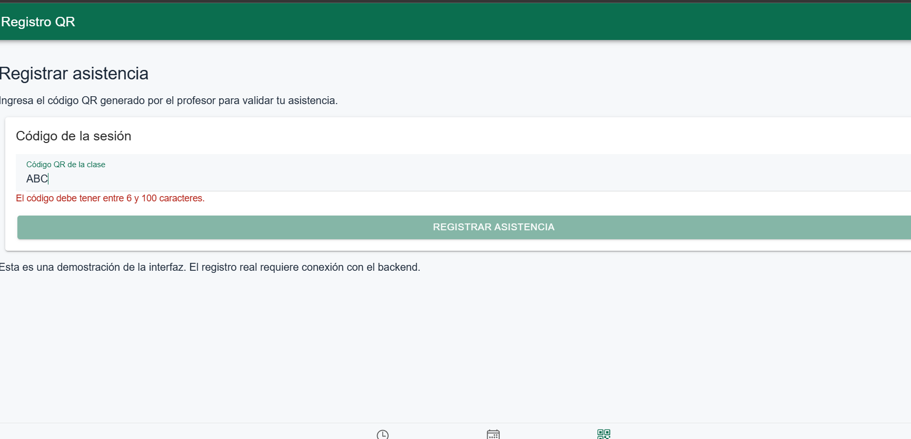
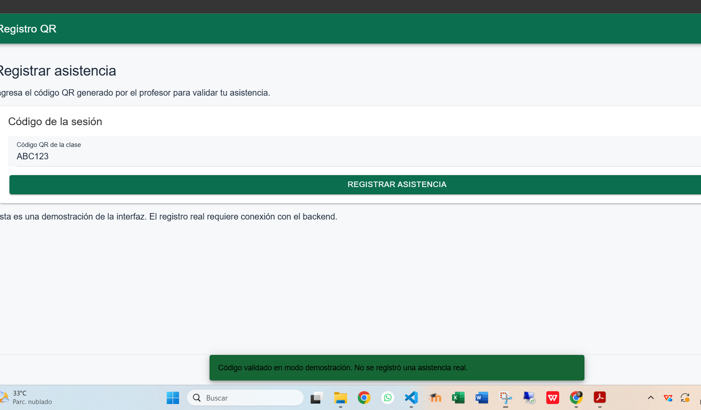
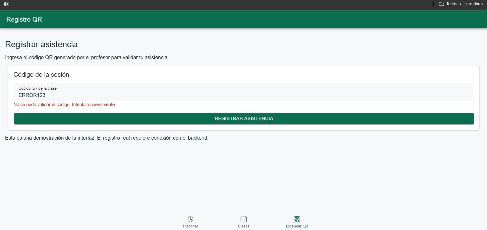

# CP6 - QR Registration Form

## 1. Overview

The Attendance Control application includes a QR registration
form for students.

This workshop version allows students to enter a session
code manually and receive validation feedback.

The form currently uses simulated responses and does not
register real attendance in the backend.

## 2. Form Validation

| Field | Validation | Purpose |
|---|---|---|
| QR code | Required | Prevent empty submissions |
| QR code | Minimum 6 characters | Workshop validation rule |
| QR code | Maximum 100 characters | Limit input length |
| QR code | Remove surrounding spaces | Normalize the input |

The length limits are provisional interface rules.
They must be verified against the backend QR contract
before production integration.

## 3. User Feedback

The form provides:

- Field-level validation messages.
- A disabled button when the code is invalid.
- A loading spinner while processing.
- An IonAlert before submission.
- An IonToast after successful simulation.
- An error message when the simulated service fails.

## 4. Test Scenarios

| Input | Expected result |
|---|---|
| Empty | Submit button disabled |
| ABC | Validation error |
| ABC123 | Confirmation and success toast |
| ERROR123 | Simulated service error |
| Cancel confirmation | Submission cancelled |

The code ERROR123 is used only to simulate a failure.

## 5. Form Screenshots

### Invalid Input

### Confirmation

### Successful Simulation

### Service Error

## 6. Implementation

The QR registration form is implemented in:

`app/src/features/attendance/forms/QrRegistrationForm.tsx`

It is displayed in the QR registration tab through
`StudentTabsPages.tsx`.

The component uses Ionic React and React state
to manage validation, loading, confirmation, and feedback.

## 7. Verification

The form was manually tested using the workshop
simulation scenarios.

The next integration step is to validate QR tokens
through the Attendance Control backend API.
