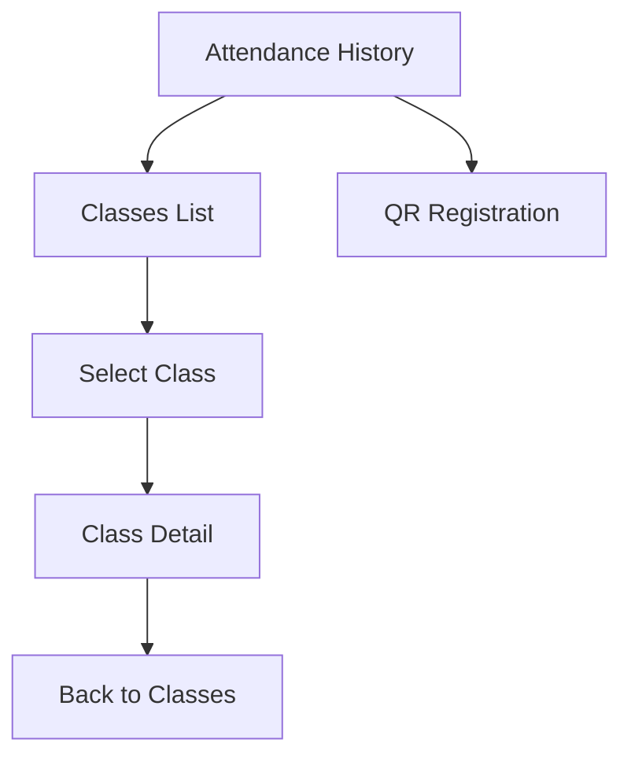

# CP7 - Class Detail and Navigation Flow

## 1. Objective

Improve navigation in Attendance Control by allowing
students to access class details directly from the class list.

## 2. Implemented Screens

- Attendance History
- Classes List
- Class Detail
- QR Registration

## 3. Navigation Flow



## 4. Routes

| Route | Screen |
|---|---|
| /tabs/historial | Attendance History |
| /tabs/clases | Classes List |
| /clases/:id | Class Detail |
| /tabs/escanear | QR Registration |

## 5. Class Detail States

The class detail screen includes:

- Loading state while the class is retrieved.
- Data state with class information.
- Error state for simulated failures.
- Not-found state for unknown class identifiers.
- Back button to return to the class list.

## 6. Navigation Improvement

Previously, the application did not provide a direct
navigation flow from the classes list to class details.

Now, students can select a class, review its information,
and return to the list.

The flow reduces unnecessary navigation and provides
clearer access to class information.

## 7. Current Limitations

Class information is currently simulated.

The detail screen must later connect to the
Attendance Control backend.

## 8. Verification

The following command completed successfully:

```bash
npm run build
```

The application was checked using the class list
and class detail routes.
