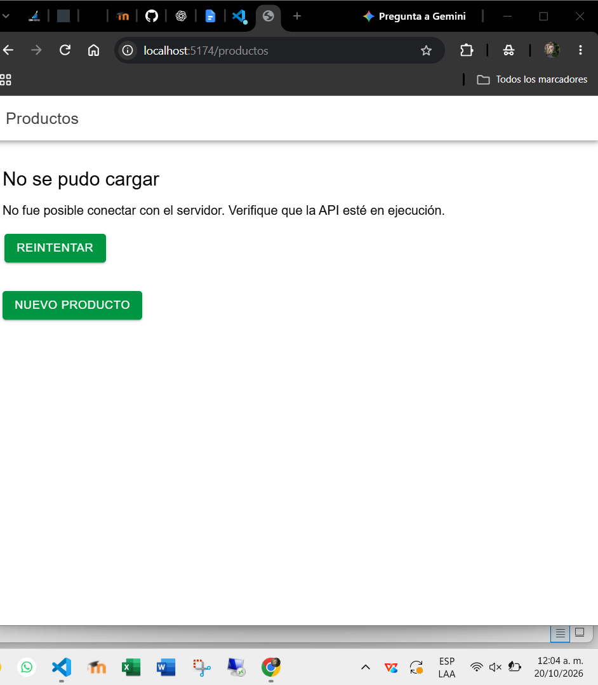
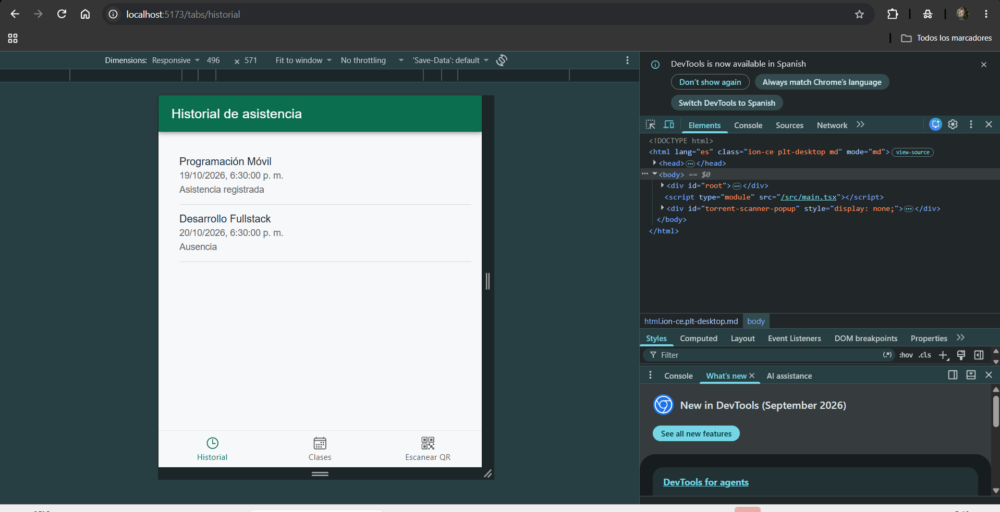
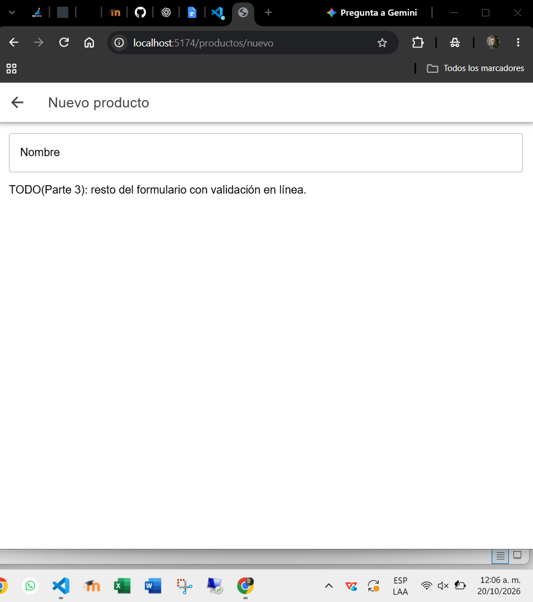
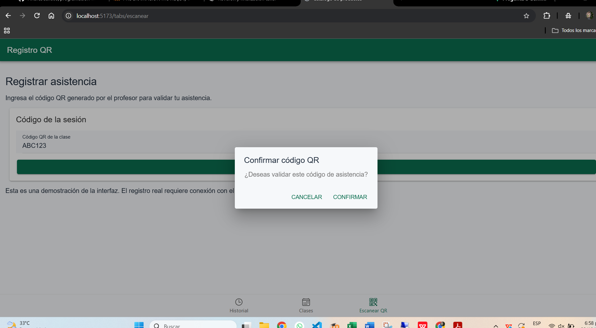

# CP9 - Before and After UX/UI Improvements

## 1. Project

- Application: Attendance Control
- Technology: Ionic React
- Main features: Attendance History, Classes, QR Registration

## 2. Attendance History

### Before

The original starter displayed a product catalog instead of
student attendance records.

### After

The application displays attendance records with course
names, dates, and attendance status.

Loading, empty, and error states were added.

## 3. QR Registration

### Before

The starter provided a product form without QR validation.

### After

The new form includes field validation, confirmation,
loading feedback, success messages, and error handling.

## 4. UX Improvements

- Consistent navigation using tabs.
- Clear loading and error feedback.
- Form validation before submission.
- Accessible viewport configuration.
- Responsive design for mobile and tablet screens.

## 5. User Stories

### US1 - Attendance History

As a student, I want to review my attendance history
so that I can identify my attendance records.

Acceptance criteria:
- Display course name and attendance status.
- Show loading, empty, and error states.
- Allow users to retry failed requests.

### US2 - QR Registration

As a student, I want to receive feedback when submitting
a QR code so that I understand the result.

Acceptance criteria:
- Validate required input.
- Disable submission when input is invalid.
- Show confirmation and processing feedback.
- Display success or error messages.

### US3 - Class Details

As a student, I want to open a class from the class list
so that I can review its information.

Acceptance criteria:
- Open the detail using the class identifier.
- Display class information.
- Show a not-found message for invalid identifiers.
- Provide a button to return to the list.

## 6. Next Steps

The current application uses simulated data.
The team must integrate these improvements with the
Attendance Control backend.
